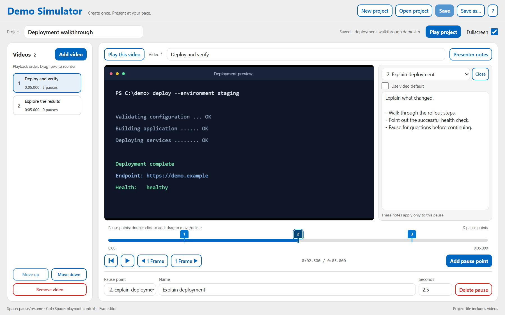

# Demo Simulator

Live demos can go wrong. Prerecorded videos avoid many surprises, but they don't wait while you explain a step or answer a question.

**Demo Simulator gives you the reliability of a recording with control over the pace.** Add pause points to your videos, keep talking points in presenter notes, and resume when you're ready. Jump back to revisit a step without restarting the demo.

Arrange multiple videos into a walkthrough and keep the recordings, pause points, and notes together in one portable `.demosim` file. Everything runs locally, with no account, uploads, or internet connection required. Playback is silent, leaving the narration to you.

Recorded-cursor removal is not implemented. Start with cursor-free recordings; any cursor already baked into a video remains visible.



## Quickstart

### Run from source

Prerequisites: Windows, Git, and Node.js 22.12 or later with npm.

```powershell
git clone https://github.com/markrussinovich/DemoSimulator.git
Set-Location DemoSimulator
npm ci
npm run build
npm start
```

Dependency installation requires internet access; the built application runs offline.

Select **New project**, give it a name, and choose **Add video**. Seek to a point, select **Add pause point**, then **Save**. Choose **Play project**, click the video to start, and click again or press Space at each pause to continue.

### Build a Windows application

```powershell
npm run package
& '.\Demo Simulator.cmd'
```

Packaging creates the direct application, an installer, and an extract-once ZIP in `release\`. Build outputs and sample recordings are not checked into this repository.

### Launch a packaged build

Run **`Demo Simulator.cmd`** from this source folder after packaging, or open **`release\win-unpacked\Demo Simulator.exe`** directly.

For another machine, install **`release\Demo Simulator Setup 1.1.1.exe`**, then use its desktop/Start menu shortcut. Alternatively, extract the 1.1.1 ZIP **once**, keep the extracted files together, and run `Demo Simulator.exe`. Node.js is not needed.

**Do not use the old `Demo Simulator 1.0.0.exe` portable launcher.** That format decompresses Electron into a temporary directory every time it starts, causing the long delay. The new installer and extract-once ZIP avoid this. Startup also no longer waits for the previous project to load before showing the editor shell. Builds are unsigned; Windows may show a reputation warning.

Measured interactive launches of the final package were **0.3–1.6 seconds**, compared with **16.2 seconds** for the old portable launcher. Restoring a saved three-video project and decoding its preview took **0.57 seconds**. The first launch immediately after a fresh build was **4.6 seconds**, so startup is not guaranteed to be instantaneous under all conditions. Bundled startup dependencies also reduce the application archive from 14.8 MB to 0.49 MB.

## Create, save and open

1. **New project** (Ctrl+N): creates a blank project immediately, with no workspace setup.
2. Name the project and **Add video**. Imported MP4/WebM files are copied; originals are never edited.
3. Drag video rows to reorder them, or select a video and use **Move up / Move down**. **Remove video** removes only that entry from the project.
4. **Save** (Ctrl+S): choose a `.demosim` file on first save. The single file includes the videos, their order, and all pause points. Later saves update it.
5. **Open project** (Ctrl+O): open a `.demosim` file. **Save as...** (Ctrl+Shift+S) writes an independent copy without changing the prior file.

The header shows saved/unsaved status and the filename. New/Open and closing warn about unsaved edits. Presentation can use unsaved edits without forcing a save. Saving large videos takes time; a floating progress notification allows cancellation and the prior saved file remains intact until the new archive is complete. Progress and error notifications do not move the editor controls.

Projects are cached locally for media playback and reopening after launch. These caches are not the portable project file; use **Save** to preserve and share edits.

## Edit the timeline

- The editor has **one timeline**, with a live playhead and blue pause markers; the selected marker has a contrasting fill and outline. Native video controls are intentionally removed to avoid duplicate seek bars.
- Click or drag the timeline to scrub; the preview and time readout stay synchronized.
- **Double-click the timeline** to add a pause point at that position, or use **Add pause point** at the current playhead. Select a marker to edit its name or exact time in seconds.
- **Drag a pause marker** along the timeline to move it and scrub the video simultaneously.
- **Drag a marker off the timeline and release** to delete it. Escape cancels a drag. A click selects without changing its time.
- Marker keyboard controls: Left/Right moves 33 ms; Shift+Left/Right moves one second; Delete/Backspace deletes. **Delete pause** is also available.
- Dense markers narrow to avoid covering neighbors. Every marker can also be selected from the pause-point dropdown.
- The **Play triangle / Pause bars** button starts or pauses the editor preview. Clicking the preview also toggles playback. Preview honors authored pause points; Play or another click continues past the held point.
- **Reset** (a left arrowhead against a vertical line), to the left of Play/Pause, stops the preview and returns to the beginning. Pauses fire again when replayed after Reset or seeking backward.
- The directional **1 Frame** buttons step backward/forward approximately one frame. Exact stepping is not guaranteed, especially for variable-frame-rate inputs.
- Click outside a marker or its inspector to clear the pause selection. Editing the name/time in the inspector keeps the selection.
- **Presenter notes** toggles the notes editor to the right of the video. Drag its left divider to resize it; the width is remembered across runs. Notes follow the latest pause reached by the playhead while scrubbing or previewing; before the first pause, the panel shows **Video default**. Choose a notes entry to seek to that pause (or the beginning for Video default). Type to customize a pause's notes; **Use video default** resets it to the shared notes. Notes are saved in the project file and hidden by default during presentation.

The preview scales to the available window instead of pushing controls below it. Video margins are black in both the editor and player, in light and dark themes. The video list scrolls within its panel; there are no Prev/Next page controls. Pause details use a single inspector rather than an ever-growing form. All editor controls fit without page scrolling at the supported minimum window size.

## Present

**Play project** plays every video in order. **Play this video** presents only the selected video. Both start on the opening frame, paused, and honor authored pause points. **Fullscreen is enabled by default**; clear the checkbox for windowed presentation. Move the editor to the intended demo monitor before starting.

| Input | Result |
| --- | --- |
| Space | Start/resume, or pause actively playing video |
| Ctrl+Space | Pause and slide open the bottom playback controls; press again to close without resuming |
| Hold mouse at bottom edge for 1 second | Pause and slide open the timeline |
| Hold mouse at right edge for 1 second | Pause and slide open the matching presenter notes |
| Enter or primary click on video | Start the opening frame or resume a pause; does not advance a finished video |
| Space at a non-final video's end | Load the next video's opening frame, paused |
| Space again | Start the next video |
| Switch away | Pause; returning does not resume or advance |
| Escape | Return to editor and stop audio |

The playback controls show pause markers and a draggable position slider, with **Start of video**, **Previous pause**, and **Play** buttons. Click a numbered pause to seek there. **Play** or **Space** resumes and slides the controls away. Seeking backward rearms later pauses; seeking to a pause resumes past that pause. At a non-final video's end, **Next video** loads the next opening frame paused.

Hover-opened panels stay open while the pointer is inside and slide away when it leaves, without resuming playback. Ctrl+Space-opened controls stay open until dismissed or playback resumes. The read-only presentation notes show the latest reached pause's notes (including inherited defaults) and use the editor's remembered width. **Play** or **Space** hides either panel and resumes. Notes opened this way are visible on the presentation screen.

During presentation, the real OS cursor stays hidden over the video, including while paused. It appears only over an open timeline or notes panel and error-recovery buttons; the editor keeps its normal cursors. Video playback is always muted in both the editor and player; original audio tracks remain intact in the project files. The final video holds its last frame; it never loops automatically. Use the playback controls to return to its start, or exit and play again.

## Previous projects

Old `.demosim` archives open directly. For the original folder-based version, choose **? > Open a previous-version workspace...** and select its folder.

Each previous playlist becomes a multi-video project, preserving its name, order, repeated entries, and pause points. Standalone videos become one-video projects. When several projects are recovered, select one in **Recovered project** and save each as its own `.demosim` file. Original workspace manifests and recordings are not rewritten.

## Development insights

Explore the [development session insights (PDF)](insights/report.pdf), including the conversation timeline and usage estimates. The report was generated with [Agent Session Insights](https://github.com/markrussinovich/agent-session-insights).

Raw session snapshots and machine-specific discovery data are not included. Download the HTML report and player from `insights` for interactive playback.

## Build and validation

```powershell
npm ci
npm run build
npm start
npm run typecheck
npm run lint
npm test
npm run test:e2e
npm run package
npm run test:packaged
```

`package` produces a per-user Windows installer, extract-once ZIP, and direct `win-unpacked` executable. `test:packaged` runs the Electron scenarios against the direct packaged executable.

Close the packaged app before rebuilding it. To build and test alongside an open instance without replacing its files:

```powershell
npm run build
npx electron-builder --win nsis zip --config.directories.output=release\updated
$env:DEMOSIM_EXECUTABLE = Join-Path $PWD 'release\updated\win-unpacked\Demo Simulator.exe'
npm run test:packaged
Remove-Item Env:\DEMOSIM_EXECUTABLE
```

Unit tests need no sample recordings. Electron workflow tests use two local MP4s in `Samples\` and a locally generated WebM with audio. The recordings are deliberately excluded from Git: provide two MP4 recordings before running `test:e2e` or `test:packaged`. The current sample workflow expects its first alphabetically sorted recording to have a duration of approximately 101.133 seconds; adjust that fixture metadata in `tests\e2e\demo.spec.ts` when substituting recordings.

Workflows cover document lifecycle and cancellation, old-format migration, drag/reorder, marker move/delete/cancel, keyboard alternatives, responsive layout, frame reference comparisons, silent playback, preview cue stops, focus handling and two-step playback.

For native window startup measurements:

```powershell
.\scripts\measure-startup.ps1 -Executable '.\release\win-unpacked\Demo Simulator.exe'
```

Import limits: 32 GiB compressed/expanded project archive, 20,000 entries, and 16 MiB manifest. Unsafe paths, symlinks, duplicate paths, unsupported schemas and missing references are rejected.

## Project structure

| Location | Purpose |
| --- | --- |
| `src\main` | Electron lifecycle, native dialogs, project storage and media access |
| `src\shared` | Versioned schemas and typed IPC contracts |
| `src\renderer` | React editor, timeline, presentation player and styles |
| `tests` | Unit and Electron workflow tests |
| `scripts` | Packaging validation, startup measurements and bundled license notices |

The renderer is sandboxed with context isolation and no Node integration. A narrow preload bridge handles local file operations. Imported media is managed locally; saving creates a portable archive rather than referencing the original recording path.

## Limits

MP4 (H.264/AAC) and WebM are supported subject to runtime decoding capabilities. HTML video can transiently overshoot before seeking back to a pause point; it is not a frame-exact editing engine. Verify your recording on the demo machine, including physical Alt-Tab and monitor placement.

Recorded-cursor removal, recording, trimming, compositing, transcoding, and cloud services are not included. **A cursor baked into a recording remains visible.**
